<p align="center">
  
</p>

<h1 align="center">Volta</h1>

<p align="center">
  Simulador de física para Windows, organizado en módulos y orientado al temario de Física MEXT.
</p>

<p align="center">
  <a href="https://github.com/Eliam4510/volta-fisica/actions/workflows/pruebas.yml"></a>
  <a href="https://github.com/Eliam4510/volta-fisica/actions/workflows/compilacion.yml"></a>
  <a href="https://github.com/Eliam4510/volta-fisica/releases/latest"></a>
  <a href="LICENSE"></a>
</p>

<p align="center">
  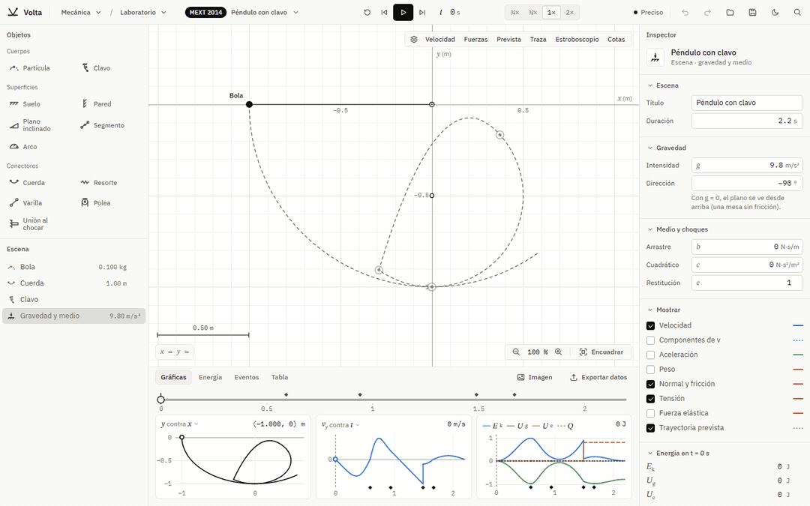
</p>

## Qué es

Volta es un simulador de física: sirve para ver cómo evoluciona un sistema en
el tiempo, construyendo uno mismo la situación con total libertad. Cada
módulo es un laboratorio completo de su área (mecánica, electrostática,
termodinámica…) y trae tres tipos de escenarios ya hechos: tutoriales para
aprender a usarlo, ejemplos clásicos y las situaciones de los exámenes de
Física MEXT reconstruidas como escenas normales.

No es un solucionario: no muestra respuestas ni explicaciones. Muestra la
física.

Principios del proyecto:

- **Física exacta.** Los cambios de régimen (un choque, una cuerda que se
  afloja, un cuerpo que se despega) se calculan en el instante exacto, y cada
  motor se valida contra soluciones analíticas con pruebas automáticas.
- **El color significa física.** La interfaz es tinta sobre papel; el color
  solo codifica magnitudes (velocidad, fuerza, campo…) y siempre con el mismo
  significado en todos los módulos.
- **Cantidades según ISO 80000**: símbolos en cursiva, unidades en redonda,
  cifras tabulares, prefijos SI.

## Módulos

| Módulo | Estado | Qué simula |
|---|---|---|
| Mecánica | Utilizable | Proyectiles y Laboratorio (caja de arena): superficies, cuerdas, poleas, resortes, varillas, clavos, fricción y choques entre discos |
| Electrostática | Utilizable | Cargas, campo, potencial, cargas en movimiento |
| Termodinámica | Utilizable | Gas en cilindro con émbolo, calor, trabajo, diagrama P-V |
| Gravitación | Utilizable | Órbitas, escape, leyes de Kepler, órbita geoestacionaria |
| Circuitos | Utilizable | Corriente continua, redes de capacitores, transitorios RC, RL y LC |
| Magnetismo e inducción | Planeado | Fuerza de Lorentz, inducción electromagnética |
| Ondas y sonido | Utilizable | Cuerdas y tubos (reflexión, uniones, modos, resonancia) y Doppler con audio; la cubeta 2D, en preparación |
| Óptica | Utilizable | Trazado de rayos (Snell, Fresnel, reflexión total, prismas con dispersión, lentes y espejos), interferencia y difracción por suma de Huygens, películas delgadas, anillos de Newton y Michelson |
| Física moderna | Planeado | Efecto fotoeléctrico, núcleo |

El plan completo, con dependencias y orden de implementación, está en
[PLAN.md](PLAN.md).

## Capturas

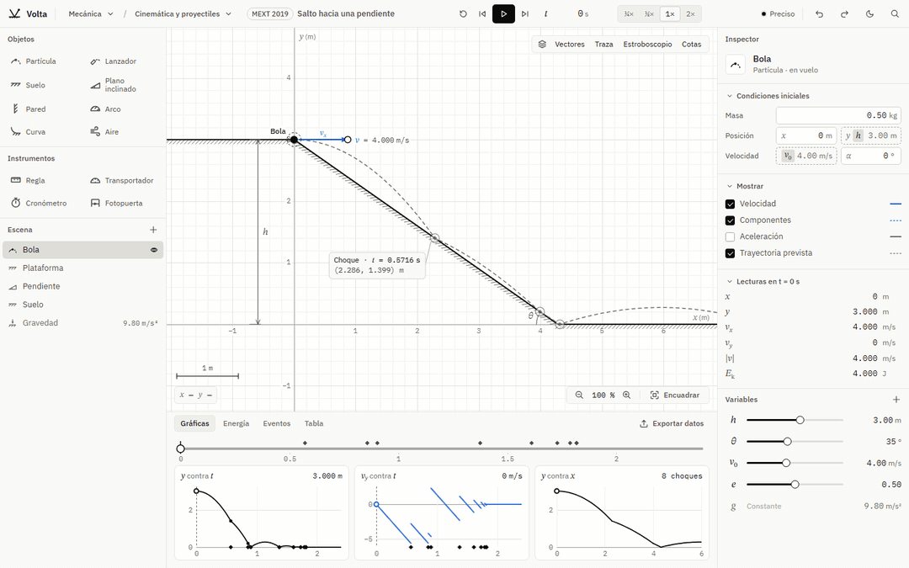

| Mecánica | Electrostática |
|---|---|
| 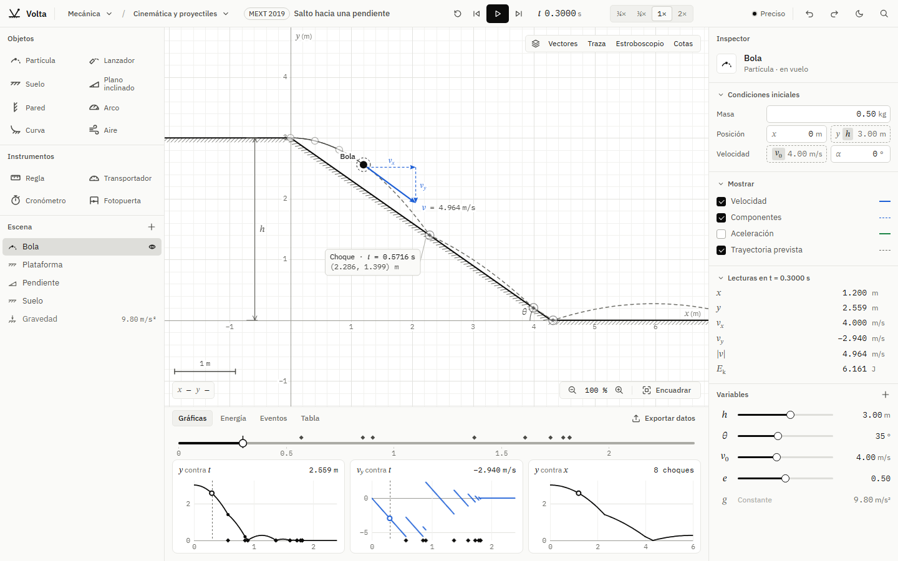 | 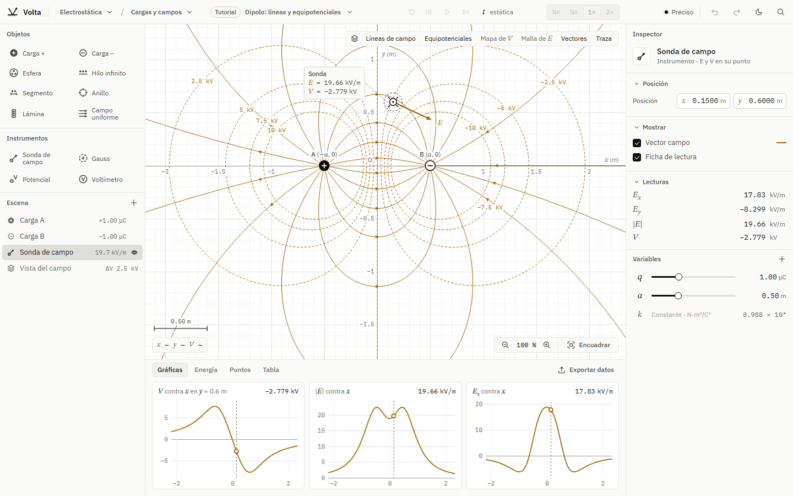 |

| Termodinámica | Inicio |
|---|---|
| 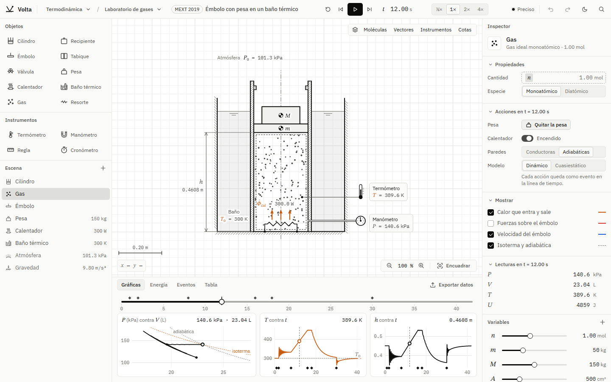 | 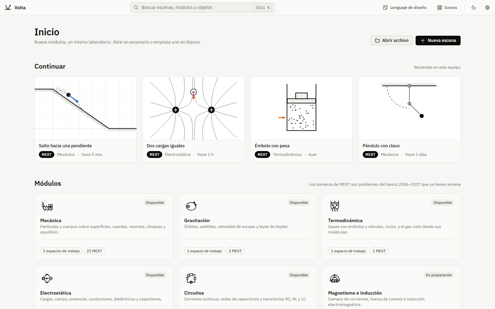 |

| Gravitación | Circuitos |
|---|---|
| 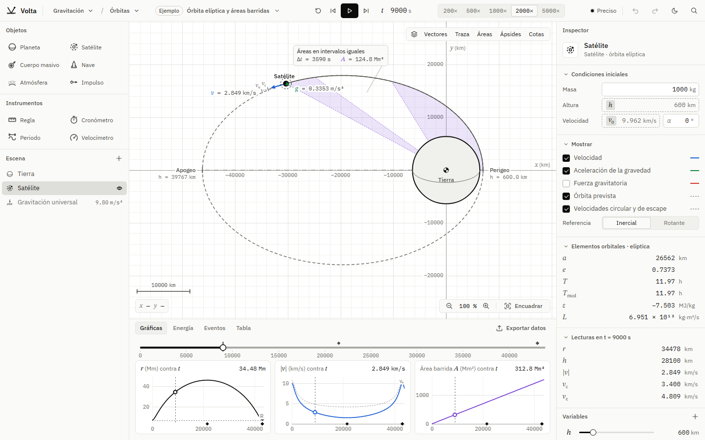 | 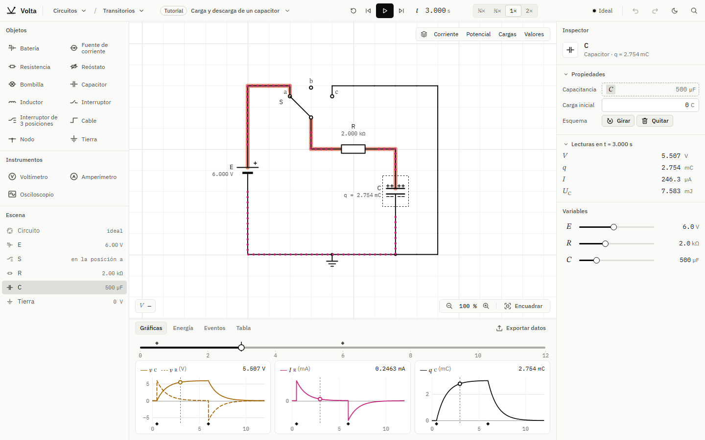 |

| Ondas: medio 1D | Ondas: Doppler y acústica |
|---|---|
| 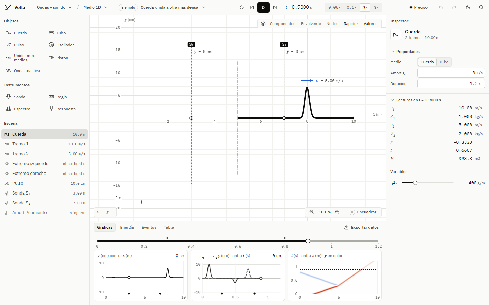 | 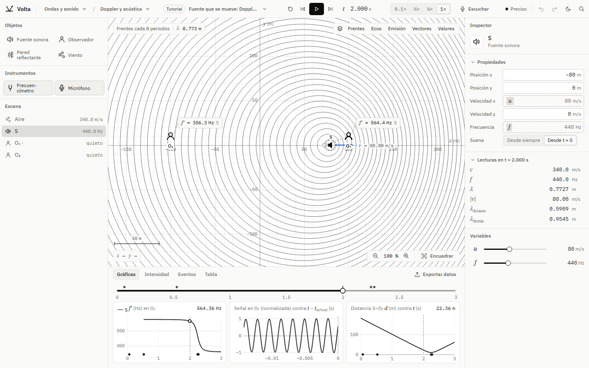 |

| Óptica geométrica | Interferencia y difracción |
|---|---|
| 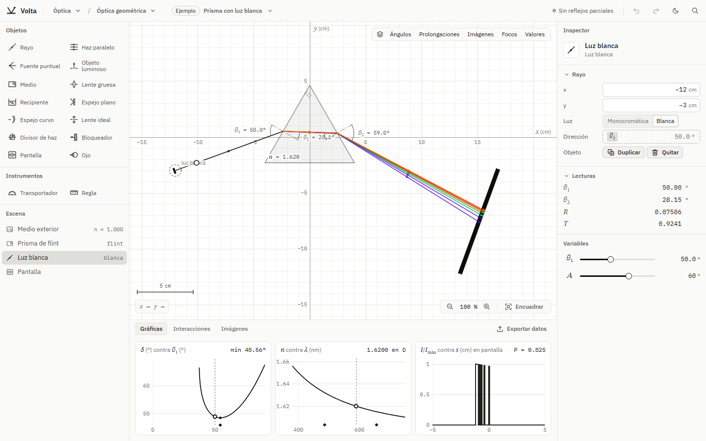 | 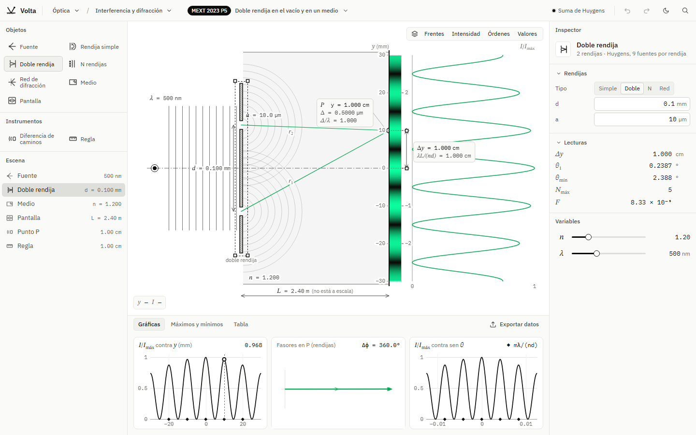 |

| Películas e interferómetros | |
|---|---|
| 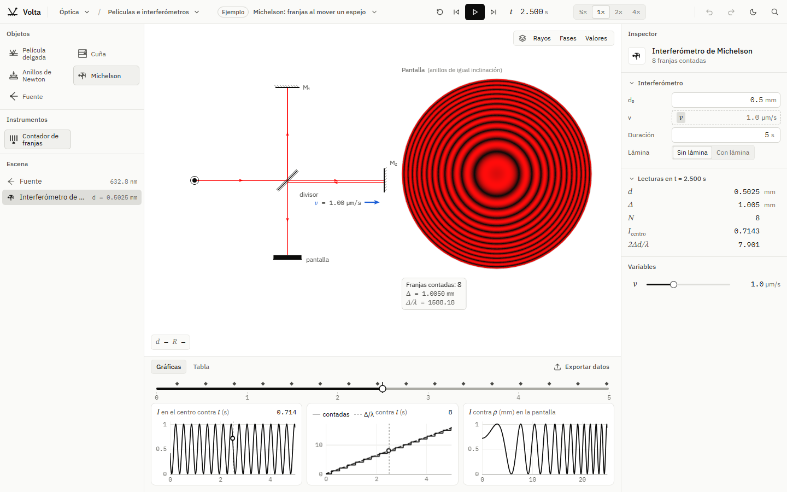 | |

## Instalación

1. Descarga la última versión desde
   [Releases](https://github.com/Eliam4510/volta-fisica/releases/latest):
   - `Volta_x.y.z_x64-setup.exe`: instalador (se instala para el usuario
     actual, sin permisos de administrador);
   - `Volta_x.y.z_x64_portable.exe`: ejecutable portátil, sin instalación.
2. Requiere Windows 10 o 11 con WebView2 (incluido en Windows 11).

## Compilación

Requisitos: [Node.js](https://nodejs.org/) 22 o superior,
[Rust](https://www.rust-lang.org/tools/install) estable y, en Windows, las
herramientas de compilación de C++ de Visual Studio.

```bash
git clone https://github.com/Eliam4510/volta-fisica.git
cd volta-fisica
npm install
npm test          # pruebas de física e integridad
npm run banco     # rendimiento de los motores
npm run dev       # abre la aplicación en modo desarrollo
npm run compilar  # genera el instalador en src-tauri/target/release/bundle/
```

Para trabajar solo en la interfaz, sin compilar Rust, basta con un servidor
estático en la raíz del proyecto (`npm run servir`) y abrir
`http://localhost:8811/sistema/prototipos/inicio.html`.

## Estructura

```
sistema/        interfaz servida por la aplicación
  nucleo/       funciones puras compartidas (formato ISO 80000, …)
  motores/      motores físicos puros, sin interfaz, con pruebas
  lienzo/       gramática visual (trazo.js), gráficas y símbolos por dominio
  componentes/  componentes de interfaz y comportamiento común
  tokens/       tokens de diseño (tokens.json es la fuente única)
  iconos/       242 iconos (fuente, sprite y catálogo)
  fuentes/      IBM Plex Sans, IBM Plex Mono, STIX Two Text (OFL)
  prototipos/   pantallas: inicio, mecánica, electrostática, termodinámica, guía
src-tauri/      aplicación de Windows (Tauri 2, Rust)
pruebas/        pruebas automáticas (Vitest)
docs/           análisis del temario, arquitectura, lenguaje de diseño, módulos
```

## Documentación

- [Análisis del temario MEXT](docs/01_analisis_temario.md)
- [Arquitectura](docs/02_arquitectura.md)
- [Visión y plataforma común](docs/03_vision_y_plataforma.md)
- [Lenguaje de diseño](docs/04_lenguaje_de_diseno.md) y su guía viva en
  `sistema/prototipos/guia.html`
- [Especificación de cada módulo](docs/modulos/)
- [Decisiones de diseño y técnicas](DECISIONES.md)
- [Registro de cambios](CHANGELOG.md)

## Licencia

Código bajo licencia [MIT](LICENSE). Las fuentes incluidas se distribuyen
bajo la SIL Open Font License 1.1.

El banco original de exámenes MEXT no forma parte de este repositorio; las
escenas MEXT de Volta son reconstrucciones propias de cada situación física.
