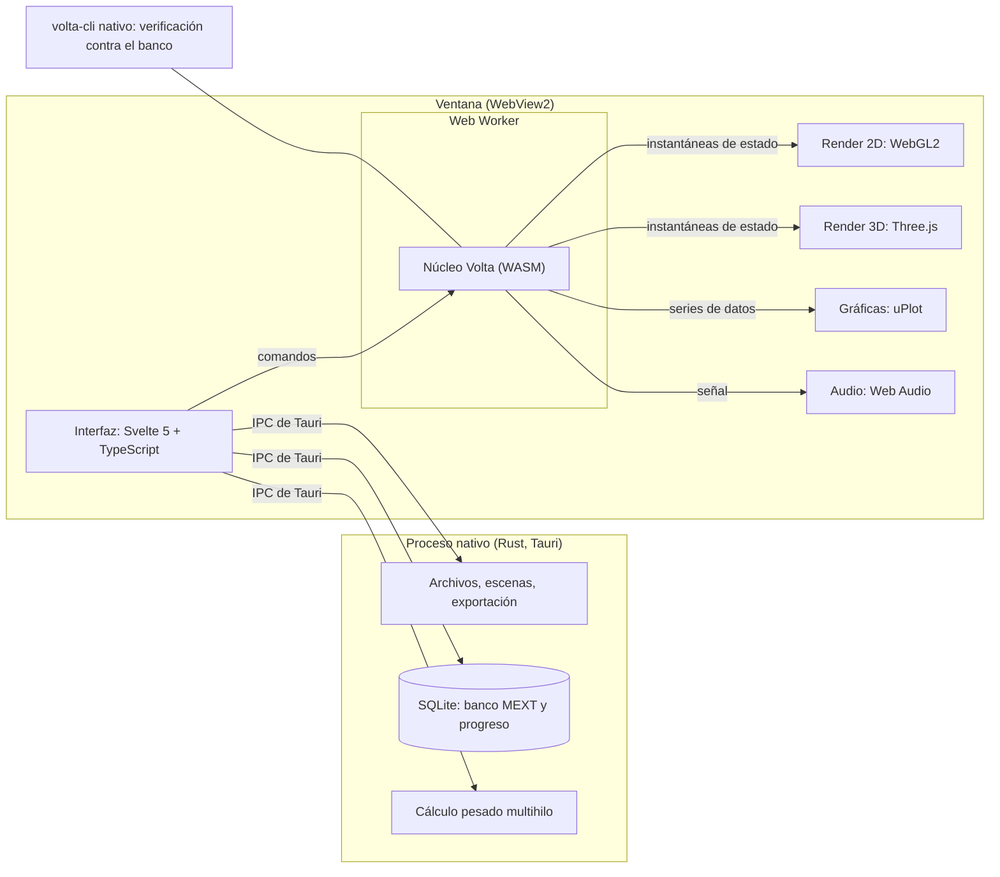

# Volta — Propuesta de arquitectura

Suite de simulación de física para Windows, organizada en módulos que cubren
el temario de Física MEXT. Volta es un simulador general de física: el
temario decide qué cubre cada módulo, pero no lo convierte en una herramienta
de examen. La visión y la plataforma común están en
`03_vision_y_plataforma.md`; cada módulo, en `modulos/`. Este documento parte
del análisis en `01_analisis_temario.md`.

> **Estado de la implementación (v0.x).** La aplicación usa Tauri 2 como se
> propone aquí, pero la física y la interfaz están en JavaScript moderno
> (módulos ES, sin empaquetador) y no en Rust compilado a WASM: los motores
> viven en `sistema/motores/` y `sistema/nucleo/`, son puros (sin DOM) y
> tienen pruebas automáticas, de modo que pueden pasar a Rust/WASM cuando el
> rendimiento lo pida. Los motivos están en `DECISIONES.md` (decisiones 3 y
> 4) y la estructura vigente en `PLAN.md`.

## 1. Qué significa "profesional" en este proyecto

Requisitos medibles, no adjetivos:

| Eje | Requisito |
|---|---|
| Fidelidad | Las escenas de examen reproducen la clave con error relativo menor que 1e-6. Las escenas conservativas pierden menos de 1e-9 de energía relativa por periodo. |
| Eventos | El instante de un cambio de régimen (normal nula, cuerda floja, choque) se localiza con precisión de máquina, no "en el siguiente paso". |
| Rendimiento | Pantalla a la frecuencia del monitor con un campo 2D de 256×256 recalculado mientras se arrastra una carga, 2000 moléculas de gas o una cubeta de ondas de 512×512, en una laptop con gráficos integrados. |
| Arranque | Menos de 2 s; funciona sin internet. |
| Distribución | Instalador de Windows normal, ventana propia, sin navegador ni consola. |
| Verificación | Cada escena MEXT se comprueba automáticamente contra la clave en cada cambio de código. Es una prueba interna de calidad; la aplicación no muestra respuestas. |
| Acabado | Diseño coherente, tema claro y oscuro, alta densidad de píxeles, deshacer y rehacer, autoguardado, exportación de datos e imágenes. |

## 2. Plataforma

### Recomendación

**Aplicación de escritorio con Tauri 2.** Ventana nativa de Windows que
dibuja su interfaz con WebView2 (el motor de Edge que ya trae Windows 11). El
núcleo de física se escribe en Rust y se compila dos veces: a WebAssembly, para
correr dentro de la ventana en tiempo real, y a código nativo, para la
verificación automática y los cálculos pesados.

No es un servidor web. Tauri entrega los archivos de la interfaz por un
protocolo interno que se intercepta dentro del propio proceso; no se abre
ningún puerto ni se usa un navegador. Para el usuario es un `.exe` instalado
como cualquier otro programa.

### Por qué esta y no otra

| Opción | A favor | En contra | Veredicto |
|---|---|---|---|
| **A. Tauri 2 + núcleo Rust (WASM y nativo) + interfaz TypeScript** | Interfaz rica con poco esfuerzo; el banco ya viene en HTML con LaTeX y se muestra tal cual con KaTeX; audio con Web Audio; instalador pequeño; el núcleo es independiente de la interfaz | Dos lenguajes; WebGPU no es estable en WebView2, así que la base es WebGL2 | **Recomendada** |
| B. Rust nativo: wgpu + egui (como el visor Rerun) | Un solo lenguaje y un solo proceso; máximo rendimiento sobre Direct3D 12 | Aspecto de herramienta interna salvo mucho trabajo de diseño; mostrar enunciados con LaTeX y figuras exige convertirlos antes; menos componentes de interfaz | Plan B: comparte el mismo núcleo |
| C. C++20 + Qt 6 (QML, Qt Quick 3D) | Estándar de software técnico (ParaView, FreeCAD); 3D integrado | Desarrollo y compilación lentos; licencia LGPL; gráficas y LaTeX por separado | Sobredimensionado para el valor que añade |
| D. C# + WinUI 3 o WPF | Muy integrado con Windows | 3D y GPU vía interoperabilidad; WinUI 3 todavía con asperezas | No |
| E. Electron | Igual que A, con Chromium propio (WebGPU garantizado) | Instalador de más de 100 MB y más memoria | Solo si WebView2 diera problemas |
| F. Python + Qt | Rápido para prototipos | Distribución pesada; menor rendimiento y acabado | Solo para herramientas internas, como el análisis del banco |
| G. Servidor local + navegador | Simple | Depende del navegador y de un puerto; no se siente como aplicación | Descartada |

La decisión que importa a largo plazo es separar el núcleo de física de la
interfaz. Si algún día la ventana web se queda corta, se cambia a la opción B
sin tocar una sola línea de física.

## 3. Arquitectura general



- **Núcleo (Rust).** Física pura: sin interfaz, sin dependencias del
  navegador, determinista. Se prueba sin pantalla.
- **Worker.** El núcleo compilado a WASM corre en un hilo aparte para que la
  interfaz nunca se congele. Entrega el estado como búferes transferibles de
  números (sin copiar objetos), así que no depende de `SharedArrayBuffer`.
- **Interfaz (TypeScript).** Paneles, controles, gráficas, enunciados y
  herramientas de medición. Solo lee el estado y envía órdenes.
- **Render.** WebGL2 para escenas 2D y campos (mapas de calor, cubeta de
  ondas en la GPU); Three.js solo donde el 3D aporta algo (órbitas, campo de
  hilos, efecto Hall, generador).
- **Proceso nativo.** Archivos, base de datos, exportación de video con ffmpeg
  y cálculos que valga la pena paralelizar en varios núcleos.

Es el mismo patrón modelo-vista que usan las simulaciones PhET de la
Universidad de Colorado, que son la referencia en simulaciones educativas de
física.

## 4. Núcleo de simulación

### 4.1 Tiempo

- Hay un tiempo físico y un tiempo de pantalla. La velocidad se ajusta entre
  0.01× y 100× sin afectar la precisión.
- Los modelos de tiempo real avanzan con paso fijo (con acumulador) y la
  pantalla interpola entre pasos.
- Los modelos de examen usan integración adaptativa con salida densa: el
  integrador da una curva continua entre pasos, de modo que cualquier cuadro y
  cualquier evento se evalúan exactamente donde caen.

### 4.2 Motor de fases y eventos

Es la pieza central, porque la mitad de los problemas largos cambian de
régimen (ver hallazgo 1 del análisis).

- **Fase:** conjunto de ecuaciones y restricciones activas. Ejemplos: "sobre
  la esfera", "en vuelo", "cuerda tensa", "bloques pegados".
- **Evento:** una función del estado que cruza cero en una dirección dada.
  Ejemplos: normal = 0, tensión = 0, y = 0, velocidad relativa = 0.
- **Transición:** un mapa que reinicia el estado al cruzar. Ejemplos: choque
  con coeficiente de restitución e, la cuerda se tensa de golpe, se abre una
  válvula.
- **Localización:** se acota el cruce dentro del paso y se refina con el
  método de Brent sobre la salida densa, hasta precisión de máquina.
- **Protección contra infinitos rebotes:** la pelota que rebota con e < 1 hace
  infinitos rebotes en tiempo finito; por debajo de un umbral se declara en
  reposo.

### 4.3 Integradores

| Uso | Método | Motivo |
|---|---|---|
| Escenas de examen con fases | Dormand–Prince 5(4) adaptativo con salida densa | Error muy bajo y eventos exactos |
| Órbitas y oscilaciones largas | Verlet de velocidad o Yoshida de 4.º orden (simplécticos) | La energía no deriva con el tiempo |
| Cargas en campo magnético | Boris | Conserva la energía cinética en B puro, donde RK4 deriva |
| Circuitos | Análisis nodal modificado con regla trapezoidal o BDF2; Newton para elementos no lineales | Mismo enfoque que SPICE |
| Ondas 1D y 2D | Diferencias finitas leapfrog con condición CFL; bordes absorbentes | Estable, barato y apto para la GPU |
| Conductores y dieléctricos | Poisson con multimalla | Converge en pocas iteraciones en mallas grandes |
| Gas microscópico | Dinámica molecular por eventos de esferas duras | Colisiones exactas, sin paso de tiempo |

### 4.4 Observables, historial y línea de tiempo

- Un **observable** es una cantidad con nombre calculada del estado:
  energía, momento, flujo magnético, corriente, temperatura, frecuencia
  recibida.
- Cada observable se guarda en un **historial** por columnas. Con eso se
  dibujan las gráficas, se exportan datos y se responde al examen.
- La **línea de tiempo** permite retroceder y avanzar sin volver a integrar.
  Si se cambia un parámetro a mitad de la simulación, se abre una rama desde
  ese instante.
- El **libro mayor de energía** es un observable estándar en todos los
  módulos: trabajo de cada fuerza, energía almacenada, calor disipado. Debe
  cuadrar en todo momento; si no cuadra es un error de programación.

### 4.5 Unidades y determinismo

- Todo en SI con `f64`. Cada parámetro de escena lleva su unidad y se muestra
  con prefijos y con las cifras significativas del examen.
- Misma entrada, mismo resultado, bit a bit: sin aleatoriedad sin semilla y
  sin depender del orden de tablas hash en la física.

## 5. Solucionadores por módulo

### Mecánica
- Partículas con restricciones en coordenadas reducidas (círculo, curva
  paramétrica, plano), con cálculo explícito de la normal y la tensión para
  los eventos.
- Choques 1D y 2D por impulsos (componentes normal y tangencial, coeficiente
  e).
- Fricción de Coulomb con estados "pegado" y "deslizando" (bloques apilados).
- Cuerpo rígido 2D para estática: sistema de equilibrio de fuerzas y
  momentos, con comprobación de que las fuerzas de contacto sean posibles.
- Gravitación con integrador simpléctico y la órbita de Kepler analítica como
  referencia.
- Hidrostática: Pascal y flotación.

### Termodinámica
- **Macroscópico:** estado del gas ideal (n, P, V, T, especies) con procesos
  cuasiestáticos; mecánica del émbolo acoplada (masa, atmósfera, inclinación,
  cilindro volteado); Q, W y ΔU por tramo; diagramas P-V, V-T y P-T; ciclos y
  eficiencia.
- **Microscópico:** dinámica molecular de esferas duras con émbolo móvil,
  válvula entre recipientes y mezcla de especies. La presión se mide por el
  impulso sobre las paredes, se ve la distribución de Maxwell y la adiabática
  PV^γ aparece sola, sin programarla.

### Ondas
- Cuerdas y tubos 1D por diferencias finitas, con bordes fijo, libre, abierto
  y absorbente; vista transversal y longitudinal (desplazamiento contra
  densidad o presión).
- Superposición analítica para instantáneas exactas tipo examen.
- Cubeta de ondas 2D en la GPU, con velocidad variable por zona (refracción),
  paredes y fuentes móviles.
- **Doppler exacto:** cada frente nace en la posición de la fuente y viaja con
  el aire, que se mueve con el viento. La frecuencia recibida se obtiene
  resolviendo el tiempo de emisión; la reflexión en una pared móvil se trata
  con una fuente imagen. Se sintetiza el audio que oye el observador, con
  pulsaciones incluidas.

### Óptica
- Trazador de rayos 2D: medios con forma, ley de Snell, intensidad de Fresnel,
  reflexión total, dispersión con el color de cada longitud de onda, y
  búsqueda de la imagen virtual para la profundidad aparente.
- Óptica ondulatoria por suma de fasores: N rendijas, red de difracción,
  envolvente de rendija, película delgada con cambio de fase en la reflexión
  y Michelson con lámina insertable y conteo de franjas.

### Electromagnetismo
- Electrostática por superposición (cargas puntuales, hilos, planos), líneas
  de campo integradas desde las cargas, equipotenciales por marching squares,
  energía potencial U(x, y), superficie gaussiana con flujo calculado.
- Conductores y dieléctricos con Poisson (conductores flotantes con carga
  fija) e imágenes para la esfera.
- Circuitos por análisis nodal modificado: interruptores como eventos,
  formulación por cargas para que la carga se conserve en nodos aislados entre
  capacitores, bombilla no lineal con recta de carga, transitorios RC, RL, LC y
  RLC, y libro de energía (batería, capacitores, inductores, resistencias). Se
  reaprovechan el diseño y la batería de pruebas del motor de Hakaru CES.
- Biot–Savart numérico para segmentos y espiras.
- Partículas cargadas con Boris: selector de velocidades, espectrómetro,
  efecto Hall con modelo de deriva.
- Inducción: flujo por intersección de la espira con la región de campo (o
  integral cerrada para un hilo), ecuación electromecánica acoplada (velocidad
  terminal), sentido de la corriente por Lenz y generador rotatorio.

### Física moderna
- Efecto fotoeléctrico con curva I-V y potencial de frenado.
- Cadenas de decaimiento (A, Z) y retroceso por conservación del momento.

## 6. Formato de escena

Cada escena es un archivo JSON validado por un esquema. Los tipos se definen
una sola vez en Rust; de ahí se generan el esquema JSON y los tipos de
TypeScript, para que el núcleo y la interfaz nunca discrepen.

Ejemplo, problema 3 de 2017 (bola que deja el hemisferio). El bloque
`verificacion` solo lo lee el verificador automático; la aplicación lo
ignora:

```json
{
  "id": "mext-2017-p3",
  "titulo": "Bola que se separa de un hemisferio",
  "modulo": "mecanica",
  "parametros": {
    "m": { "valor": 0.10, "unidad": "kg" },
    "R": { "valor": 1.0,  "unidad": "m" },
    "g": { "valor": 9.8,  "unidad": "m/s^2" }
  },
  "cuerpos": [
    { "id": "bola", "tipo": "particula", "masa": "m",
      "posicion": [0, "R"], "velocidad": [1e-9, 0],
      "nota": "Perturbación mínima: en el equilibrio inestable exacto no se mueve." }
  ],
  "fases": [
    { "id": "sobre_esfera",
      "restriccion": { "tipo": "circulo", "centro": [0, 0], "radio": "R", "lado": "exterior" },
      "salidas": [ { "evento": "normal(bola) = 0", "hacia": "vuelo" } ] },
    { "id": "vuelo",
      "salidas": [ { "evento": "y(bola) = 0", "hacia": "fin" } ] }
  ],
  "observables": {
    "cos_tB": "cos(angulo(bola)) en transicion(sobre_esfera, vuelo)",
    "vC":     "rapidez(bola) en fin",
    "vCx":    "vx(bola) en fin"
  },
  "verificacion": [
    { "reactivo": "2017/3-(3)", "observable": "cos_tB", "esperado": "2/3" },
    { "reactivo": "2017/3-(4)", "observable": "vC",     "esperado": "sqrt(2*g*R)" },
    { "reactivo": "2017/3-(5)", "observable": "vCx",    "esperado": "(2/3)*sqrt(2*g*R/3)" }
  ]
}
```

Las expresiones (`esperado`, eventos, observables) usan un lenguaje pequeño de
fórmulas con su propio analizador en el núcleo; nunca se evalúa código
arbitrario.

## 7. Escenarios MEXT

- **Son escenas normales** en la biblioteca de cada módulo: reproducen la
  situación del examen con los mismos objetos y medidas, y se pueden
  modificar. No muestran soluciones, pasos ni respuestas.
- **Metadatos:** año, problema y la figura original como referencia visual.
- **Verificación interna:** el bloque `verificacion` de cada escena permite
  que `volta-cli verificar` compruebe en cada cambio de código que el motor
  reproduce la clave. Es control de calidad, invisible para el usuario.
- **Cobertura:** un reporte interno dice qué porcentaje del banco ya tiene
  escena.
- **Banco y figuras.** El banco original (`Fisica.csv`) y sus 124 figuras se
  usan localmente (`escenarios/figuras/`) pero no se publican en el
  repositorio: son material de los exámenes. Las escenas MEXT de Volta son
  reconstrucciones propias de cada situación física.

## 8. Experiencia de usuario

La distribución de pantalla, la edición de escenas, el manejo del tiempo, las
herramientas de medición, las gráficas, el barrido de parámetros y los
archivos están especificados en `03_vision_y_plataforma.md`.

## 9. Verificación y calidad

1. **Pruebas del núcleo:** orden de convergencia de cada integrador, deriva de
   energía, simetrías.
2. **Referencias analíticas:** alcance del proyectil, periodo del MAS, periodo
   de Kepler, constante RC, frecuencia LC, separación de franjas de Young.
3. **Regresión contra el banco:** `volta-cli verificar` corre todas las
   escenas sin pantalla y las compara con la clave. Se ejecuta en cada cambio
   (integración continua en GitHub Actions).
4. **Pruebas visuales:** capturas automáticas de la interfaz para detectar
   regresiones.
5. **Rendimiento:** escenas de referencia con medición de cuadros por segundo.

## 10. Estructura del repositorio

```
Volta/
├── Fisica.csv              banco original, sin modificar
├── analisis/               clasificación del banco
├── docs/                   análisis, arquitectura, plataforma
│   └── modulos/            especificación de cada módulo
├── nucleo/                 workspace de Cargo
│   ├── volta-nucleo/       matemáticas, unidades, integradores, eventos, historial, fórmulas
│   ├── volta-escena/       formato de escena, fases, observables
│   ├── volta-cuerpos/      motor de cuerpos común (restricciones, contactos, choques)
│   ├── volta-mecanica/
│   ├── volta-gravitacion/
│   ├── volta-termo/
│   ├── volta-electrostatica/
│   ├── volta-circuitos/
│   ├── volta-magnetismo/
│   ├── volta-ondas/
│   ├── volta-optica/
│   ├── volta-moderna/
│   ├── volta-wasm/         enlace con la interfaz
│   └── volta-cli/          verificación sin pantalla
├── app/
│   ├── src-tauri/          proceso nativo
│   └── ui/                 interfaz Svelte + TypeScript
└── escenarios/
    ├── tutoriales/
    ├── ejemplos/
    ├── mext/               una escena por problema
    └── figuras/            figuras originales del banco
```

## 11. Hoja de ruta

### Orden de los módulos

| Fase | Contenido | Por qué en este lugar |
|---|---|---|
| 0. Plataforma | Aplicación Tauri, interfaz común (lienzo, inspector, variables, línea de tiempo, gráficas, archivos), núcleo con integradores, eventos e historial | Todo lo demás se apoya en ella |
| 1. Mecánica | Motor de cuerpos común y los siete espacios de trabajo | 30 % del temario; construye el motor que usan Gravitación, Electrostática y Magnetismo |
| 2. Gravitación | N cuerpos sobre el motor común | Barato después de Mecánica |
| 3. Termodinámica | Laboratorio de gases, ciclos, gas molecular, calor | 21 % del temario y presente en todos los exámenes |
| 4. Electrostática | Superposición, Poisson, cargas en movimiento | Base de Circuitos y Magnetismo |
| 5. Circuitos | Análisis nodal, transitorios | Reaprovecha Hakaru CES |
| 6. Magnetismo e inducción | Biot–Savart, Boris, inducción acoplada | Necesita el motor de cuerpos y los circuitos |
| 7. Ondas y sonido | Medio 1D, cubeta 2D, Doppler con audio | Motores independientes |
| 8. Óptica | Rayos y fasores | Motores independientes |
| 9. Física moderna | Fotoeléctrico y núcleo | Menor peso |

La plataforma no se construye "en vacío": se desarrolla junto con el primer
espacio de trabajo de Mecánica (cinemática y proyectiles), para que cada
pieza común se pruebe con física real desde el principio.

### Ciclo de trabajo por módulo

1. **Diseño detallado:** modelo de datos, objetos, parámetros y maquetas de
   la interfaz. Se muestran dos o tres maquetas antes de programar.
2. **Motor:** física del núcleo con sus pruebas (referencias analíticas,
   conservación, convergencia).
3. **Interfaz:** paleta, inspector, instrumentos y vistas del módulo.
4. **Escenarios:** tutoriales, ejemplos y escenas MEXT con su verificación
   interna.
5. **Revisión:** capturas reales, pulido y criterios de rendimiento.

Un módulo se da por terminado cuando todos sus escenarios MEXT pasan la
verificación y la revisión visual está aprobada.

## 12. Riesgos y decisiones abiertas

- **WebView2.** WebGPU no está activado en el canal estable y el soporte de
  `SharedArrayBuffer` es incierto. El diseño no depende de ninguno: WebGL2 como
  base y búferes transferibles entre hilos.
- **Banco incompleto.** Faltan los exámenes de 2011, 2021, 2022, 2024 y 2026,
  2025 solo tiene la lista de temas y 2027 está reconstruido de memoria (hay supuestos marcados como
  "assumed" en el propio CSV).
- **Alcance.** Son nueve módulos y 39 subtemas. Sin terminar cada módulo
  antes de empezar el siguiente es fácil acabar con muchos a medias.
- **Precisión contra libertad.** El modo preciso de Mecánica (eventos
  exactos) escala a decenas de cuerpos, no a miles; para escenas masivas hay un
  modo de paso fijo menos exacto. La interfaz debe dejar claro qué modo está
  activo.
- **Nombre.** "Volta" ya lo usan un gestor de herramientas de Node.js (cuyo
  ejecutable es `volta.exe`) y una arquitectura de GPU de NVIDIA. Como nombre
  del producto no hay problema; para el ejecutable y el repositorio conviene
  algo compuesto, como `volta-fisica`.
- **Decisión pendiente del usuario:** confirmar la opción A (Tauri) o preferir
  la B (Rust nativo con egui).
